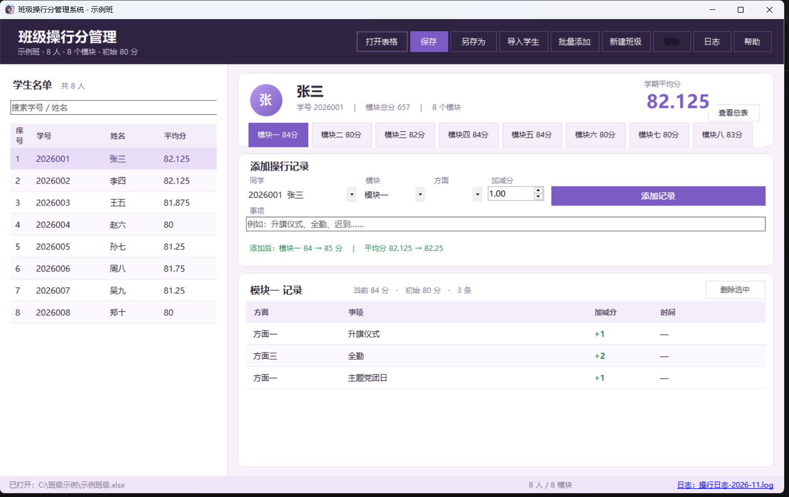

# 班级操行分管理系统

> 面向大学班级操行委员的 Windows 桌面工具：在原有 Excel 模板上直接记操行分，自动累计模块分与学期平均分，每月独立日志。

当前版本：**1.1.0**（新增批量添加、全班加分与班级 logo 主题）。



## 这个程序解决什么问题

很多班级的操行分表格是“一个学生一行、每个模块两列（模块分 + 明细）”的 Excel 模板。每次加一条记录，都要手动找到学生、找到模块、在很长的明细单元格末尾追加文字、再心算修改模块分和平均分，既慢又容易错。

这个程序把这件事变成固定流程：

> 选择同学 → 选择模块 → 选择方面几 → 输入事项 → 输入加减分 → 点击“添加”

点击添加后：

- 新记录会按模板原有格式追加到对应模块的明细单元格；
- 该模块分自动重新计算；
- 学期平均分自动重新计算；
- 本次操作立即写入按月生成的日志文件；
- 点击“保存”后写回 Excel，并自动备份原文件。

## 主要功能

- **直接打开现有模板**：自动识别学生、模块分、模块明细、合并表头、列宽和平均分公式，保存时尽量保留原格式。
- **固定添加流程**：同学、模块、方面、事项、加减分，一键添加，自动累计。
- **批量添加**：一次勾选多名同学或“全选（全班）”，为每人添加同一条记录；每位同学分别累计，支持一次撤销整批操作。
- **模块分/平均分自动计算**：模块分 = 初始分 + 该模块所有记录的加减分；平均分 = 各模块分之和 ÷ 模块数。
- **删除与撤销**：误加、误删都可以撤销；删除前会二次确认。
- **自定义班级**：模块数量（1—20）、每个模块的方面数量（1—30，可分别设置）、模块名称、初始分（0—1000）。
- **导入学生**：支持 `.xlsx` / `.xlsm` / `.csv` / `.txt`，也支持直接粘贴“学号 + 姓名”两列；可替换或追加，追加时自动跳过重复学号。
- **每月独立日志**：日志放在表格同目录的 `操行日志` 文件夹，文件名如 `操行日志-2026-11.log`；包含时间、操作、学生、模块、方面、事项、加减分、模块分变化和平均分变化。
- **自动备份**：每次保存前把原表格复制到 `表格备份` 文件夹，默认保留最近 40 份。
- **班级总表**：查看所有学生所有模块分和平均分，可按平均分排序，可导出 CSV。
- **搜索**：学生名单支持按学号/姓名即时筛选。
- **快捷键**：`Ctrl+S` 保存、`Ctrl+O` 打开、`Ctrl+N` 新建、`Ctrl+Z` 撤销。
- **单文件、零依赖**：一个 exe，无需安装 Python/Node/Office，不联网。

## 直接运行

1. 打开 `班级操行分管理系统` 文件夹。
2. 双击 `班级操行分管理.exe`。
3. 首次运行若 Windows SmartScreen 提示“未知发布者”，点击“更多信息”→“仍要运行”即可（程序未做代码签名）。
4. 需要 Windows 10 / Windows 11；系统自带的 .NET Framework 4.8 即可运行。极少数精简系统若提示缺少 .NET Framework，请安装 4.8。

> 想先体验：点击“打开表格”，选择 `示例\示例班级.xlsx`。该文件使用虚构学生数据，可放心试用。

> 程序不会修改你打开的原表格，除非你点击“保存”。保存时也会先生成备份。

## 三种开始方式

### 方式一：打开上个月的表格继续记录（最常用）

1. 点击顶部 **打开表格**，选择你的操行分模板（`.xlsx`）。
2. 程序会自动识别：
   - 学生学号、姓名；
   - 每个模块的当前分数；
   - 每个模块已有的明细文字；
   - 每个模块的方面数量（按已有记录中的最大“方面几”推断，至少为 5）；
   - 初始分（按“模块分 − 已有明细合计”的众数推断，通常为 80）。
3. 在左侧选择学生，在“添加操行记录”卡片中选择模块、方面，填写事项和加减分。
4. 点击 **添加记录**。该模块的明细、模块分、平均分会立即更新，并写入日志。
5. 点击 **保存**（或 `Ctrl+S`）。程序会：
   - 在表格同目录的 `表格备份` 文件夹生成一份原文件备份；
   - 在原文件基础上更新对应单元格，保留表头合并、列宽、字体、边框等格式；
   - 重新写入平均分公式的缓存值。

> 如果表格正在 Excel / WPS 中打开，保存会失败。请先关闭那个表格窗口再保存。

### 方式二：新建一个班级

适合其他班级、其他学校，或者模板格式完全不同的情况。

1. 点击顶部 **新建班级**。
2. 填写：
   - 班级名称；
   - 模块初始分（默认 80）；
   - 模块数量（默认 8）；
   - 每个模块的名称和方面数量（默认“模块一”……“模块八”，每个 5 个方面）。
3. 点击 **创建班级**。
4. 程序询问是否立即导入学生名单；选择“是”，然后：
   - 从 `.xlsx` / `.csv` / `.txt` 文件导入；或
   - 直接粘贴两列“学号、姓名”。
5. 保存为新的 `.xlsx` 文件。

新建的表格会按程序内置样式生成：两行合并表头、冻结窗格、模块分列 + 明细列、平均分公式，和你的模板布局一致。

### 方式三：只导入/更新学生名单

1. 打开一个已有班级的表格，或先新建班级。
2. 点击 **导入学生**。
3. 选择“从文件导入”或“粘贴名单”。
4. 选择“追加到现有名单（跳过重复学号）”或“替换现有名单”。
5. 先点 **读取预览** 检查学号和姓名是否对应正确，再点 **导入**。
6. 保存时如果名单发生变化，程序会按当前名单重新排列数据行，但保留表头、列宽、合并单元格和单元格样式。

## 计算规则

程序完全按你模板中的规则计算：

- **模块分** = 模块初始分 + 该模块下所有记录的加减分之和。
- **学期平均分** = 各模块分相加 ÷ 模块数量。
- 记录文字沿用模板格式：`方面一升旗仪式（1分）`、`方面四迟到（-1分）`、`方面二讲座（1.5分）`。
- 新记录追加到模块明细末尾，不覆盖原有文字。
- 模板中原本没有“方面几”的记录（例如“纪律委员（4分）”）会显示为“未标注”，但分数照常参与计算。

打开模板时，如果某个模块的分数和明细合计对不上，程序会保留差额并在打开时给出提示，避免破坏你已有的数据。

## 日志与备份

### 日志

- 位置：表格所在目录下的 `操行日志` 文件夹。
- 文件名：`操行日志-YYYY-MM.log`，每月一个文件，跨月自动新建。
- 编码：UTF-8（带 BOM），记事本、VS Code 均可正常打开。
- 内容：每次打开、添加、删除、撤销、导入、保存、新建班级都会记录。

示例：

```text
2026-11-14 13:34:44 | 添加记录 | 学号=2026001 | 姓名=张三 | 模块=模块一 | 方面=方面一 | 事项=升旗仪式 | 加减分=+1 | 模块分=84→85 | 平均分=82.125→82.25
2026-11-14 13:35:10 | 删除记录 | 学号=2026001 | 姓名=张三 | 模块=模块一 | 方面=方面一 | 事项=升旗仪式 | 加减分=+1 | 模块分=85→84 | 平均分=82.25→82.125
```

> 日志是纯文本，请不要用 Excel 打开后“另存为”，以免破坏编码。用记事本查看即可。

### 备份

- 位置：表格所在目录下的 `表格备份` 文件夹。
- 文件名：`原文件名_备份_YYYYMMDD_HHMMSS_fff.xlsx`。
- 每次保存前自动生成，保留最近 40 份（同一文件名）。
- 如果保存失败（例如文件被 Excel 占用），原文件不会被破坏。

## 模板格式

程序兼容你现有的这种模板：

| 列 | 内容 |
|---|---|
| A | 序号 |
| B | 学号 |
| C | 姓名 |
| D / E | 模块一 分数 / 模块一 明细 |
| F / G | 模块二 分数 / 模块二 明细 |
| … | 以此类推，每个模块占两列 |
| 最后一列 | 平均分（`AVERAGE(各模块分)`） |

- 支持任意模块数量（每个模块两列），不限于 8 个。
- 支持 1—2 行表头（程序会按合并单元格判断数据起始行）。
- 表头中需要出现“序号”“学号”“姓名”“平均分”，以及“模块……”列名。
- 程序读取第一个工作表。
- 不支持旧版 `.xls`；请先在 Excel/WPS 中另存为 `.xlsx`。
- 程序会在文件的自定义属性里记录模块数、方面数、初始分、模块名称等，以便下次打开时精确恢复。

## 快捷键

| 快捷键 | 功能 |
|---|---|
| `Ctrl+S` | 保存 |
| `Ctrl+O` | 打开表格 |
| `Ctrl+N` | 新建班级 |
| `Ctrl+Z` | 撤销上一步添加/删除 |
| `Enter`（事项输入框内） | 添加记录 |

## 从源码构建

源码在 `源码` 文件夹，使用 Windows 自带的 .NET Framework 编译器，不依赖 NuGet、Visual Studio 或第三方库。

### 方法一：双击 `源码\build.bat`

脚本会调用：

```text
%WINDIR%\Microsoft.NET\Framework64\v4.0.30319\csc.exe
```

并在上级目录生成 `班级操行分管理.exe`。

### 方法二：手动编译

在 `源码` 目录打开命令提示符：

```bat
"%WINDIR%\Microsoft.NET\Framework64\v4.0.30319\csc.exe" ^
  /nologo /langversion:5 /target:winexe ^
  /out:"..\班级操行分管理.exe" ^
  /win32icon:"app.ico" /win32manifest:"app.manifest" ^
  Program.cs MainForm.cs BatchAddForm.cs Dialogs.cs Theme.cs AppConfig.cs Model.cs ^
  ChineseNumber.cs CxLog.cs XlsxCommon.cs XlsxReader.cs ^
  XlsxTemplateWriter.cs XlsxCreator.cs SaveService.cs RosterReader.cs ^
  /r:System.Windows.Forms.dll /r:System.Drawing.dll ^
  /r:"%WINDIR%\Microsoft.NET\Framework64\v4.0.30319\System.IO.Compression.dll" ^
  /r:System.Xml.dll
```

### 环境要求

- Windows 10 / 11；
- .NET Framework 4.8（系统自带）；
- 不需要安装 Office、WPS、Python、Node.js。

## 项目结构

```text
班级操行分管理系统/
├─ 班级操行分管理.exe
├─ 使用说明.md
├─ README.md
├─ LICENSE
├─ 界面截图.png
├─ logo.ico                 班级 logo 原始设计稿
├─ 示例/
│  ├─ 示例学生名单.csv
│  └─ 示例班级.xlsx         8 模块 / 5 方面 / 80 分初始分的演示表格
└─ 源码/
   ├─ Program.cs              程序入口、异常处理
   ├─ MainForm.cs             主界面与添加/删除/撤销/保存流程
   ├─ BatchAddForm.cs          批量选择学生、全班加分
   ├─ Dialogs.cs              新建班级、导入学生、总表
   ├─ Theme.cs                界面配色、卡片、表格样式
   ├─ AppConfig.cs            窗口大小等本地设置
   ├─ Model.cs                数据模型与计算规则
   ├─ ChineseNumber.cs        中文数字（模块一、方面五）
   ├─ CxLog.cs                按月日志
   ├─ XlsxCommon.cs           xlsx 公共工具、明细解析
   ├─ XlsxReader.cs           模板/名单读取
   ├─ XlsxTemplateWriter.cs   在模板副本上修改单元格（保留格式）
   ├─ XlsxCreator.cs          从零生成新表格
   ├─ SaveService.cs          保存、备份
   ├─ RosterReader.cs         学号/姓名导入
   ├─ app.ico                 程序图标
   ├─ app.manifest            以当前用户权限运行
   └─ build.bat               一键构建
```

## 技术说明

- 使用 C# / WinForms 编写，编译为单个 Windows 可执行文件。
- xlsx 本质是 ZIP + OpenXML。程序直接读取/修改 `xl/worksheets/sheet1.xml` 和 `docProps/custom.xml`，而不是把整个工作簿重新生成，因此能保留模板中的合并单元格、列宽、字体、边框、排序状态等；新增/修改的文字以 `inlineStr` 写入，模板原有的 `sharedStrings` 保持不变。
- 平均分单元格保留 `AVERAGE(...)` 公式，同时写入最新缓存值，Excel/WPS 打开后显示正确；并设置 `fullCalcOnLoad` 让公式在打开时重新计算。
- 模块分/平均分由程序按记录实时计算，不依赖 Excel 公式链。
- 日志为纯文本追加，不依赖数据库。
- 程序不联网，不上传任何学生数据。

## 常见问题

**Q：保存时提示“文件可能正被 Excel / WPS 打开”？**  
A：关闭正在打开该 `.xlsx` 的 Excel/WPS 窗口，再点保存。程序会先写临时文件，成功后才替换原文件。

**Q：打开模板后模块数、方面数不对？**  
A：程序从表头和已有明细推断。请确认表头有“模块一……”“平均分”，并确认每个模块是“分数列 + 明细列”两列。方面数取已有记录中最大的“方面几”，至少为 5；可以在新建班级时为每个模块单独设置。

**Q：模块分显示 87，但我加的是 86.5？**  
A：这是 Excel 单元格列宽/数字格式的显示问题，底层数值是 86.5。把该列拉宽，或把单元格格式设为 `0.##` 即可。

**Q：模板里原有记录的时间为什么显示“—”？**  
A：模板明细里没有时间字段。程序只记录“本次在程序内添加”的时间；所有操作的真实日期都在日志文件里。

**Q：替换名单后原来的记录没了？**  
A：替换名单会移除当前学生及其记录；在点击“保存”之前，原 Excel 文件不会被修改，可以用“表格备份”恢复。追加名单不会影响已有学生。

**Q：程序被杀毒软件误报？**  
A：程序是未签名的单文件 exe，部分杀毒软件会对“未知 exe”敏感。可将其加入信任，或从源码自行编译。

**Q：两个同学同时编辑同一个表格？**  
A：不支持并发。请各自保存不同文件，或轮流编辑。

**Q：能处理 `.xls` 吗？**  
A：不能。请先在 Excel/WPS 中“另存为” `.xlsx`。

## 许可

MIT License，详见 `LICENSE`。可自由用于班级管理、修改和二次分发。


